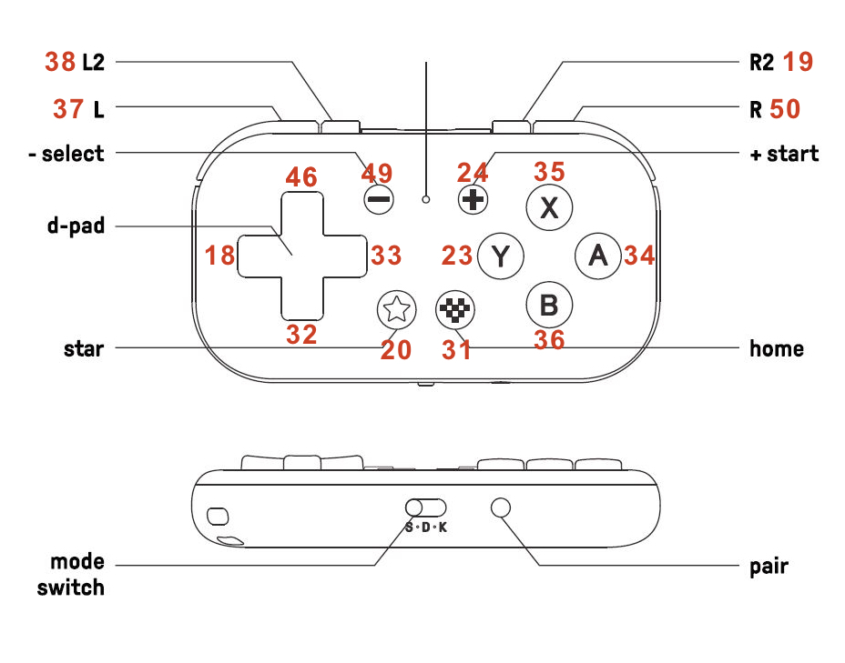

# 8BitDo Micro for PocketBook KOReader (remote control)
This guide explains how to use an **8BitDo Micro** controller as a bluetooth remote for **KOReader** on a PocketBook e-reader. 

It has been confirmed to work on the **PocketBook InkPad 4**.

The controller is held vertically, with the directional buttons at the top and the **L/R** buttons on the right, like a television remote.

This has been inspired by a [post on Reddit](https://www.reddit.com/r/koreader/comments/1ge7eje/comment/lvelsqi/) and my own struggle to have the controller working as a remote. Basically I wanted to keep a clear guide for the 8BitDo Micro remote system.

## Requirements

- A PocketBook e-reader running KOReader (updated version of [KOReader](https://github.com/koreader/koreader/releases))
- An 8BitDo Micro controller (IMPORTANT: update to Firmware v1.05 [here](https://support.8bitdo.com/firmware-updater.html))
- A computer with a plain-text or code editor, such as CotEditor (macOS), Notepad++ (Windows), or Visual Studio Code, Kate, or Gedit (Linux)
- A USB cable to connect the PocketBook to the computer
- [pocketbook8bitdo.koplugin](https://github.com/igarizio/pocketbook8bitdo.koplugin) must be installed to map KOReader events that the PocketBook has no dedicated physical key for.
  
## 8BitDo Scheme keys


## Step 1: Pair the controller

1. Set the 8BitDo Micro’s mode switch to **K** (Keyboard mode). The other modes will not work for this purpose.
2. Turn on the controller.
3. Hold the **Connect/Pair** button beside the mode switch until the LED blinks rapidly.
4. On the PocketBook, open **Settings → Bluetooth**.
5. Enable Bluetooth and wait for the controller to appear.
6. Select **8BitDo Micro gamepad** and pair it. 
7. Wait until a check mark appears beside the controller’s name. (It will show **8BitDo Micro gamepad [HID]** when paired.)

You only need to pair the controller once. However, it may not reconnect automatically when switched on again. If this happens, open **Settings → Bluetooth**, tap the controller’s name while it is switched on, and wait for the check mark to appear.

## Step 2: Create the key-mapping file

KOReader reads custom hardware-button mappings from:

```text
<your_reader>/applications/koreader/settings/event_map.lua
```

To create the file:

1. Connect the PocketBook to your computer using USB.
2. Open the reader’s storage in your computer’s file manager.
3. Navigate to `applications/koreader/settings/`.
4. Create a new file named `event_map.lua`.
5. Open it in a plain-text or code editor.
6. Copy and paste the mapping below.
7. Save the file.
8. Safely eject the PocketBook.
9. Wait until the PocketBook desktop appears, then unplug the USB cable.
10. Restart the PocketBook.
11. Reconnect the controller and launch KOReader.

## Key mapping

The following configuration maps the controller for one-handed, vertical use (see image of 8BitDo Controller):

- **Up** opens the table of contents.
- **Right** turns to the next page.
- **Left** turns to the previous page.
- **Down** closes the current menu or dialogue.
- **L** adds or removes a bookmark on the current page.
- **Minus** toggles night mode.
- **Plus** returns to the KOReader file manager (Home).

Create `event_map.lua` with the following contents (on download [here](https://github.com/MJVgeek/8BitDo-Micro-for-PocketBook-KOReader/blob/main/event_map.lua):
```
-- This is the 8BitDo Micro key mapping for KOReader in a PocketBook.
-- In this case, the controller is held vertically, with the arrow keys at the top and the L/R buttons on the right, like a TV remote.
--
-- Format: [keycode] = "KOReader event" -- description [physical button]
-- The events "...viaBT" require pocketbook8bitdo.koplugin to be installed (since they have no dedicated key names in the Pocketbook).

return {
    -- Directional buttons
    [18] = "ShowTocviaBT",        -- Open the table of contents [Up]
    [33] = "Back",                -- Close the current menu/dialog [Down]
    [46] = "LPgFwd",              -- Turn to the next page [Right]
    [32] = "LPgBack",             -- Turn to the previous page [Left]
  
    -- Side buttons
    [37] = "ToggleBookmarkviaBT", -- Add or remove a bookmark on the current page [L]
    
    -- Small buttons
    [49] = "ToggleNightModeviaBT",-- Toggle night mode [Minus]
    [24] = "Home",                -- Return to the KOReader file manager [Plus]
} 
```
## Notes
- The numeric values are input keycodes, not the characters printed on the controller.
- The comments in square brackets refer to the physical buttons on the 8BitDo Micro.
- KOReader must be restarted after saving or editing `event_map.lua`.
- If a mapping does not work, verify that the controller is still in **K** mode and that the file is saved in the correct `settings` folder.
- `Back` closes the current dialogue or menu; it does not return to the previous reading location.
- Event names may vary slightly between KOReader versions. If `ShowTocviaBT` or `ToggleBookmarkviaBT` does not work, check the exact event name at pocketbook8bitdo.koplugin.

## Troubleshooting

| Problem | Possible solution |
|---|---|
| The controller does not appear in Bluetooth settings | Ensure that it is in **K** mode and that its LED is blinking rapidly in pairing mode. |
| The controller pairs but does not respond | Reconnect it from **Settings → Bluetooth**, then restart KOReader. Also make sure the 8BitDo Micro firmware is updated to v1.05 |
| The key mappings do not work | Confirm that the file is named exactly `event_map.lua` and is located in `applications/koreader/settings/` |
| Changes are not applied | Restart the PocketBook after saving the file |
| A button performs an unexpected action | Check the keycode and event name; adjust the mapping and restart KOReader |
